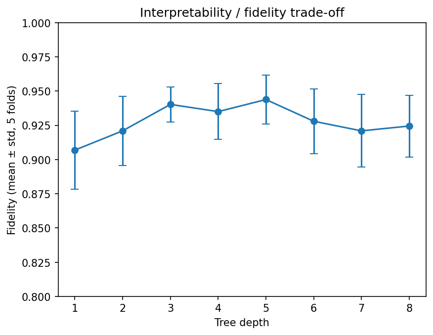

# Rule extraction from a neural network on breast cancer data

Small project exploring how to extract interpretable rules from a neural
network and measure how faithful they are, with a first step towards
logic-based (ASP) encodings.

## Overview
1. Train a small MLP (16-8 hidden units) on the Wisconsin breast cancer dataset (569 patients, 30 features).
2. Fit a shallow decision tree on the **network's predictions** (surrogate model) to obtain readable rules.
3. Measure **fidelity**: agreement between the rules and the network.
4. Translate the rules into Answer Set Programming (clingo) and check that they give the same predictions as the tree.

## Results
| Model | Result |
|---|---|
| Neural network | accuracy 0.97, AUC 0.995 (143 test patients) |
| Surrogate tree (depth 3) | accuracy vs true labels 0.944, fidelity to the network 0.937 (single split) |
| Fidelity, 5-fold CV (depth 3) | 0.940 ± 0.013 |
| ASP rules (clingo) | 100% agreement with the tree |



Fidelity plateaus around 92-94% from depth 3 onwards; deeper trees add
complexity without a clear gain (error bars overlap).

## Example rules (depth 3, 7 rules; class 0 = malignant, 1 = benign)
- worst radius > 16.80, texture error > 0.47, worst concavity > 0.19 -> malignant
- worst radius <= 16.80, worst concave points <= 0.14, area error <= 91.56 -> benign

The full set of rules is in the notebook and in `rules.lp` (ASP encoding,
values scaled by 1000 because clingo handles integers).

## Limitations
- Small dataset and small test set (143 patients): one patient is about 0.7 points.
- Some leaves rely on very few training patients (for example 5), so those rules are statistically weak.
- A single tree seems to cap fidelity near 94%. This may mean the network uses feature interactions that threshold rules do not capture (hypothesis, not tested).
- This is an exploratory exercise, not a clinical tool.

## Run
```
pip install -r requirements.txt
```
Then open `breast_cancer_rule_extraction.ipynb` (works in Google Colab).

## Next steps
Rule extraction methods designed for neural networks, ASP-based explanations, and robustness of the rules under input perturbations.
